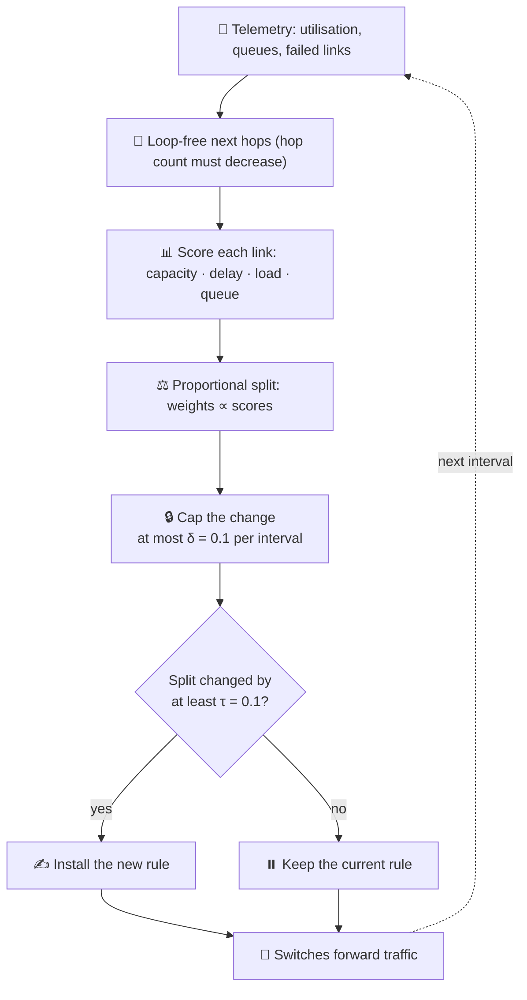
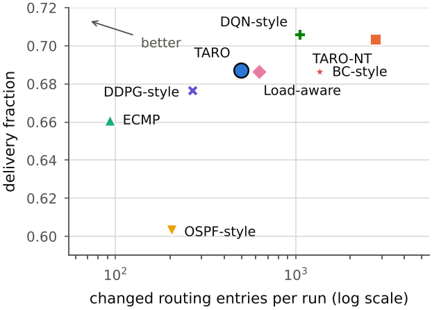
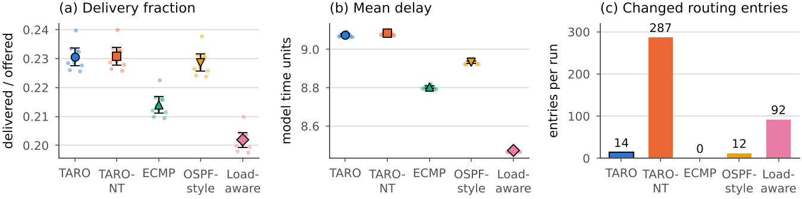
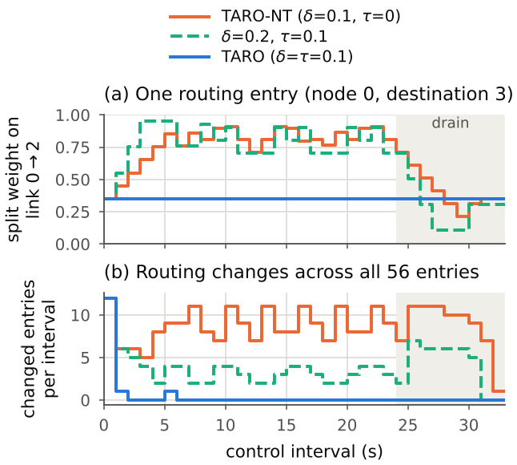
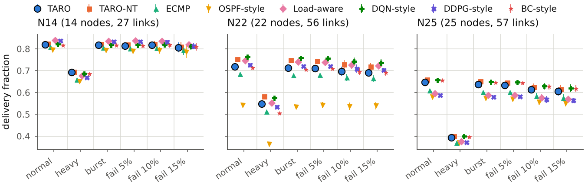
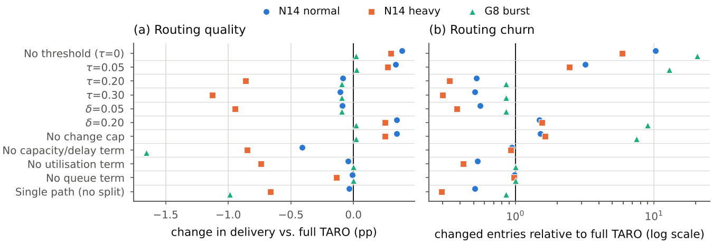

<p align="center">
  
</p>

<p align="center">
  
  
  
  
  
</p>

<p align="center">
  <b>Code, experiments and data for the paper</b><br>
  <i>TARO: Topology-Aware and Overhead-Aware Dynamic Traffic Routing for Software-Defined Networks</i><br>
  Muhammad Huzaifa (24i-0052) · Umar Jmail (24i-2104)<br>
  FAST School of Computing, National University of Computer and Emerging Sciences, Islamabad
</p>

<p align="center">
  <a href="#-at-a-glance">At a glance</a> ·
  <a href="#-how-taro-works">How it works</a> ·
  <a href="#-results">Results</a> ·
  <a href="#-quick-start">Quick start</a> ·
  <a href="#-reproduce-the-paper">Reproduce</a> ·
  <a href="#-repository-layout">Layout</a> ·
  <a href="#-citation">Citation</a>
</p>

---

## 💡 The problem

An SDN controller can move traffic away from congested links by rewriting forwarding rules in the switches.
Adaptive routing methods, including most deep-reinforcement-learning (DRL) routers, are usually judged on delay, loss and
throughput. **The cost of the rewrites themselves is rarely measured**, even though every rule change uses controller time,
switch-table writes and control-channel bandwidth, and frequent changes can reorder packets.

**TARO** is a routing policy that is designed to be judged on both: it adapts to load, and it controls how often it changes the network.

## 📌 At a glance

<table>
<tr>
<td align="center" width="33%"><h3>−95.1 %</h3>fewer routing-entry changes than the same policy without the stability threshold<br><br><sub>targeted burst, 10 seeds</sub></td>
<td align="center" width="33%"><h3>+13.9 %</h3>more delivered traffic than shortest-path (OSPF-style) routing<br><br><sub>90 paired runs on N14, N22, N25</sub></td>
<td align="center" width="33%"><h3>10 / 10</h3>seeds where TARO beats ECMP, OSPF-style and load-aware routing<br><br><sub>Wilcoxon p = 0.002</sub></td>
</tr>
</table>

- TARO delivers **4.0 % more traffic than ECMP** on the larger graphs, and **changes 80–86 % fewer entries** than its unthresholded variant (TARO-NT).
- **It is not the best at everything.** It ranks **4th of 8** methods by mean rank, and two simple load-adaptive rules (load-aware and DQN-style) deliver more. Its mean delay is 1.6–7.1 % higher than the classic baselines on the burst graph.
- **Ablations explain the results.** The delivery gain comes from the capacity- and delay-aware split weights, and the stability gain comes from the threshold.

> [!IMPORTANT]
> **Read this before reusing the results.**
> - **The evaluated TARO is a rule-based policy, not a trained neural network.** The repository also contains a GNN-PPO learner
>   prototype (`taro/ppo_numpy.py`), and **it does not learn**: the actor update has a sign error, only the last layers are updated,
>   and ratio clipping is missing. `experiments/ppo_check.py` shows this, and the paper reports it.
> - **The DQN-, DDPG- and BC-style baselines are non-learning proxies** of the routing behaviour in the cited DRL papers. They are not reimplementations of those papers.
> - **The graphs named `NSFNET`, `GEANT` and `AT&T` in the code are random graphs of the same size, not the real topologies.** The paper therefore calls them **N14, N22 and N25**.
> - **The simulator is flow-level.** The Mininet and OS-Ken adapter is optional and was not used for any number in the paper.

## ⚙️ How TARO works

Every control interval, for every (switch, destination) pair:



**Link score.** Each eligible outgoing link $`e`$ gets a score from its capacity $`c_e`$, propagation delay $`\ell_e`$, utilisation $`\rho_e`$ and queue $`q_e`$:

```math
s_e \;=\; \frac{c_e}{1+\ell_e}\;\cdot\;\bigl(1-\min(\rho_e,\,0.95)\bigr)\;\cdot\;\frac{1}{1+q_e/c_e}
```

**Stability threshold.** A new split $`w'`$ replaces the installed split $`w`$ only if the total-variation distance
$`\tfrac12\sum_e |w'_e - w_e|`$ is **at least τ**. Setting τ = 0 gives **TARO-NT**, the "no threshold" variant used as a control.
If a routing entry is empty or invalid, for example after a link failure, the simulator falls back to ECMP for that entry.

> [!NOTE]
> **There is a design lesson in this.** With δ = τ = 0.1, a capped step is usually too small to cross the threshold, so most entries
> **freeze after the first interval**. TARO then behaves like a well-chosen static split. Raising the cap to δ = 0.2 restores
> adaptation while still removing most of the churn (see Fig. 3 and Table 8 in the paper).

### Baselines

| Method | Type | How it routes |
|---|---|---|
| **TARO** (ours) | adaptive, thresholded | score-proportional split, δ = 0.1, τ = 0.1 |
| **TARO-NT** | adaptive | same policy with τ = 0 (no stability threshold) |
| ECMP | static | equal split over all next hops on shortest (hop-count) paths |
| OSPF-style | static | single shortest path by hop count |
| Load-aware | adaptive | single path, Dijkstra with link cost $`\ell_e(1+3\rho_e)`$ |
| DQN-style † | adaptive | greedy least-utilised next hop |
| DDPG-style † | adaptive | link weights grow by 0.2·ρ each interval |
| BC-style † | adaptive | next hop with the highest betweenness centrality minus utilisation |

<sub>† These are non-learning proxies of the routing behaviour in the DRL papers compared in the paper.</sub>

## 📈 Results

### Delivery versus routing churn

TARO sits in the high-delivery, low-churn corner. The three methods that change fewer entries (ECMP, OSPF-style and DDPG-style) all deliver less, and the two that deliver more (load-aware and DQN-style) change more entries.

<p align="center"></p>

### Targeted burst experiment (graph G8, 10 paired seeds)

<p align="center"></p>

| Method | Delivery | Mean delay | Changed entries | TARO's gain (pp) |
|---|---:|---:|---:|---:|
| **TARO** | **0.2306** | 9.076 | **14** | — |
| TARO-NT | 0.2308 | 9.085 | 287 | −0.02 |
| OSPF-style | 0.2287 | 8.932 | 12 | +0.19 |
| ECMP | 0.2140 | 8.803 | 0 | +1.65 |
| Load-aware | 0.2018 | 8.474 | 92 | +2.87 |

### What the stability threshold does to a routing entry

<p align="center"></p>

TARO-NT keeps adjusting splits every interval, for 287 entry changes across the network. TARO settles after the first interval, for 14 changes.
With δ = 0.2 the policy can still adapt, with 126 changes.

### Scenario matrix on N14, N22 and N25 (normal, heavy, burst, 5–15 % link failures)

<p align="center"></p>

| Method | Delivery N14 | Delivery N22 | Delivery N25 | Changed entries (N14 / N22 / N25) |
|---|---:|---:|---:|---:|
| **TARO** | 0.794 | 0.679 | 0.588 | 159 / 440 / 888 |
| TARO-NT | 0.798 | 0.712 | 0.599 | 917 / 3084 / 4352 |
| ECMP | 0.778 | 0.648 | 0.557 | 37 / 92 / 150 |
| OSPF-style | 0.768 | 0.510 | 0.533 | 71 / 211 / 331 |
| Load-aware | **0.807** | 0.704 | 0.548 | 177 / 674 / 1027 |
| DQN-style | 0.796 | **0.722** | **0.600** | 372 / 1049 / 1755 |
| DDPG-style | 0.803 | 0.686 | 0.542 | 99 / 292 / 406 |
| BC-style | 0.793 | 0.669 | 0.597 | 432 / 1793 / 1829 |

### Robustness across 30 random graphs (R30)

| TARO vs | Wins | Ties | Losses | Mean difference (pp) | Wilcoxon p |
|---|---:|---:|---:|---:|---:|
| OSPF-style | 20 | 9 | 1 | +2.00 | < 0.001 |
| Load-aware | 19 | 9 | 2 | +1.38 | < 0.001 |
| ECMP | 6 | 18 | 6 | +0.08 | 0.698 |
| TARO-NT | 3 | 19 | 8 | −0.02 | 0.229 |

TARO's advantage over ECMP is graph-dependent: G8 was the graph where TARO's gain over ECMP was largest.

### Ablation: which component does what

<p align="center"></p>

- Removing the **capacity/delay term** removes the delivery gain on G8, where TARO falls back to ECMP's 0.2140.
- Removing the **threshold** multiplies churn by **6–20×** for less than 0.4 pp more delivery.
- **Single-path** routing loses delivery and starts to flap.

## 🚀 Quick start

```bash
git clone https://github.com/HuzaifaisChaudhary/taro-sdn-routing.git
cd taro-sdn-routing
python -m venv .venv
source .venv/bin/activate            # Windows: .venv\Scripts\activate
pip install -r requirements.txt

python -m unittest discover -s tests  # Ran 10 tests ... OK
python -m taro.cli smoke-test         # one short episode on a 6-node ring
```

The results were produced with Python 3.13, NumPy 2.5, SciPy 1.18, NetworkX 3.7, pandas 3.0 and Matplotlib 3.11.
`requirements-linux.txt` adds optional dependencies (Mininet, OS-Ken, PyTorch) for the SDN emulation path. They are **not** needed to reproduce the paper.

## 🔁 Reproduce the paper

Every script is seeded and deterministic, and each takes a few minutes on a laptop. Run them from the repository root:

```bash
python -m taro.targeted_experiment          # Table 3, Fig. 2   -> artifacts/targeted_burst/
python experiments/robust.py                # Table 4           -> results/robust.json
python experiments/matrix.py NSFNET         # Tables 5 and 7    -> results/m_nsf.json    (N14)
python experiments/matrix.py GEANT          #                   -> results/m_geant.json  (N22)
python experiments/matrix.py "AT&T"         #                   -> results/m_att.json    (N25)
python experiments/matrix.py NSFNET --light # light-load check  -> results/m_light.json
python experiments/ablate.py                # Table 8, Fig. 6   -> results/abl.json
python experiments/qualitative.py           # Fig. 3            -> results/qual.json, results/freeze.json
python experiments/ppo_check.py             # Sect. 3.7         -> results/ppo_check.json, results/ppo_ref.json

python paper/make_figs.py                   # every figure      -> paper/figures/
python paper/paper_numbers.py               # every number and table row, plus checks of the paper's claims
```

`paper/paper_numbers.py` ends with assertions that check the claims written in the paper's text against the data, for example
"TARO wins on all 10 seeds" and "ranks 4th of 8". If any claim stops matching the data, the script fails.

| Paper item | Script | Data |
|---|---|---|
| Table 3, Fig. 2: targeted burst on G8 | `taro/targeted_experiment.py` | `artifacts/targeted_burst/results.json` |
| Fig. 3: one routing entry over time | `experiments/qualitative.py` | `results/qual.json`, `results/freeze.json` |
| Table 4: R30 robustness | `experiments/robust.py` | `results/robust.json` |
| Tables 5 and 7, Figs. 4 and 5: scenario matrix and base-paper comparison | `experiments/matrix.py` | `results/m_nsf.json`, `m_geant.json`, `m_att.json` |
| Table 8, Fig. 6: ablation | `experiments/ablate.py` | `results/abl.json` |
| Sect. 3.7: learner prototype check | `experiments/ppo_check.py` | `results/ppo_check.json`, `results/ppo_ref.json` |

<details>
<summary><b>Experimental settings</b> (click to expand)</summary>

| Setting | Value |
|---|---|
| G8 (targeted experiment) | 8 nodes, graph seed 4, edge probability 0.35, capacities {2, 4, 8, 16}, workload seeds 101–110 |
| R30 | graph seeds 0–29 × workload seeds 101–105 |
| N14 / N22 / N25 | `GraphSpec.random(14, 1401, 0.24)`, `(22, 1402, 0.18)`, `(25, 1403, 0.16)`; capacities {50, 100, 200}; delays U[0.5, 5] |
| Scenarios | normal, heavy (load × 2), burst, link failures 5 / 10 / 15 %; light-load check at load 0.25 |
| Matrix seeds, horizon | seeds 7–11, 20 control intervals |
| Queue limit | 4 × link capacity |
| TARO parameters | δ = 0.1, τ = 0.1 (TARO-NT: τ = 0) |
| Statistics | 95 % t-intervals, Wilcoxon signed-rank, Friedman test with Nemenyi critical difference |

`experiments/_common.py` caches shortest-path distances to speed up the runs. The cache key is the full edge list, so the
outputs are identical to uncached runs.
</details>

## 🗂️ Repository layout

```
taro-sdn-routing/
├── taro/                        # simulator, policies, baselines, metrics, statistics
│   ├── policies.py              #   StableHeuristicTARO (= TARO), HeuristicTARO (= TARO-NT)
│   ├── routing.py               #   ECMP, OSPF-style and load-aware routing, routing tables
│   ├── baselines.py             #   DQN-, DDPG- and BC-style proxies
│   ├── env.py, scenarios.py     #   flow-level network model and workload generator
│   ├── targeted_experiment.py   #   targeted burst experiment on G8
│   ├── statistics.py            #   confidence intervals, Wilcoxon, Friedman, Nemenyi
│   ├── ppo_numpy.py             #   GNN-PPO learner prototype (known not to learn, see above)
│   └── mininet_adapter.py, osken_controller.py   # optional SDN emulation path
├── tests/                       # 10 unit tests: traffic conservation, loop-free routes,
│                                #   failed links, repeatable workloads
├── experiments/                 # one script per result in the paper
├── results/                     # raw records of every experiment and the generated topologies
├── artifacts/targeted_burst/    # raw records of the targeted experiment
├── paper/
│   ├── make_figs.py             # regenerates the paper's figures (PDF + PNG)
│   ├── paper_numbers.py         # recomputes every number and checks the paper's claims
│   └── figures/
├── notebook/                    # all-in-one Jupyter notebook (Phase 3) and Windows/WSL launcher
└── docs/assets/                 # README images
```

## ⚠️ Limitations

- **Simulation only.** The results come from a flow-level simulator on synthetic graphs of 8–25 nodes, not from packet-level emulation or real traces.
- **No learned policy.** The learning component is a prototype that does not train, so TARO's results are those of the rule-based policy.
- **Proxy baselines.** The DRL baselines approximate the routing behaviour of the cited methods and do not reproduce their training.
- **The freeze effect.** With δ = τ the policy is close to static, and δ = 0.2 is the better setting for adaptation.

## 📚 Citation

```bibtex
@misc{huzaifa2026taro,
  title  = {{TARO}: Topology-Aware and Overhead-Aware Dynamic Traffic Routing for Software-Defined Networks},
  author = {Huzaifa, Muhammad and Jmail, Umar},
  year   = {2026},
  note   = {Computer Networks research project, FAST-NUCES Islamabad},
  howpublished = {\url{https://github.com/HuzaifaisChaudhary/taro-sdn-routing}}
}
```

## 👥 Authors

| Name | Roll no. |
|---|---|
| **Muhammad Huzaifa** | 24i-0052 |
| **Umar Jmail** | 24i-2104 |

## 📄 License

Released under the [MIT License](LICENSE).
